# P5: Intelligent Fine-Grained Vehicle Recognition and Analysis System

**Team ID:** to be assigned  |  **Problem:** P5  |  **Dataset:** Stanford Cars (196 classes)

| Member | USN | What they worked on |
|---|---|---|
| Yashas H V | 1RUA24CSE0546 | Vehicle detection and the classical computer-vision side (YOLO localisation, contour/GrabCut fallback and box refinement, illumination normalisation, HOG/colour/LBP features), the hybrid fusion and low-confidence handling, and the Streamlit app. |
| Yarasani Phanindar Reddy | 1RUA24CSE0542 | Training and tuning the ConvNeXt classifier, the evaluation (Top-1/Top-5, mAP, calibration), ablation, robustness tests, model optimisation (FP16/INT8/pruning), failure-case analysis, and this report. |

## 1. What we built

We built a pipeline that takes a photo of a car and returns its make, model and year, out of the 196 classes in Stanford Cars. A YOLO detector finds the car. Classical image processing (GrabCut, contour analysis, brightness correction) tidies up the crop. A fine-tuned ConvNeXt-Tiny (`convnext_tiny.fb_in22k_ft_in1k`) then does the actual classification. We also trained a classical classifier on HOG, colour, texture (LBP) and shape features, and tried fusing it with the CNN. A confidence check at the end decides whether to give a full answer, a make-only answer, or no answer.

On the 8,041 official test images, the three approaches score as follows:

| Approach | Top-1 | Top-5 |
|---|---|---|
| Classical only | 7.9% | 19.9% |
| Deep learning (YOLO box, then CNN) | **92.7%** | 98.8% |
| Hybrid (full pipeline) | 92.3% | 98.6% |

The honest summary is that the CNN does nearly all of the work. The hybrid is 0.37 points behind the plain deep-learning pipeline on clean images, and our ablation shows the GrabCut box refinement is the main reason. The classical parts are still useful for localisation fallback and as an independent second opinion, and Section 6 and Section 8 explain where they help and where they don't.

## 2. Dataset and protocol

| Item | Value |
|---|---|
| Classes | 196 (make, model, body style, year) |
| Training images used to fit models | 7,356 |
| Validation images (10% of the official training set, stratified by class) | 788 |
| Test images (official test split, never used for tuning) | 8,041 |

We used the official `.mat` annotations, which include bounding boxes and the labelled test set. Everything we had to choose (which checkpoint to keep, temperature scaling, fusion weight, crop padding, confidence thresholds) was decided on the validation images. The test set was only used for the numbers in this report. Make and year are read from the class name, which lets us report accuracy at make level, make+model level, and exact level.

Number-plate reading, tracking and traffic events were not part of the task and are not included.

## 3. How the system works

```
image -> YOLO detector --(nothing found)--> classical localiser (Canny -> contours -> GrabCut)
              |
              v
   GrabCut box refinement (only accepted if it stays close to the YOLO box)
              v
   crop + padding + brightness/contrast correction when needed (gamma + CLAHE)
              v
   ConvNeXt-Tiny with horizontal-flip averaging ---------+
              v                                          v
   classical HOG + colour + LBP + shape -> PCA -> logistic regression
              \_____ fused with a weight tuned on validation _____/
                                    v
   decision: ACCEPT (make+model+year) | MAKE ONLY | REJECT
   (if the first pass is unsure, a second pass averages a few different crops)
```

How this maps onto the required components:

| Requirement | What we did |
|---|---|
| A. Pre-processing | Adaptive gamma and CLAHE, applied only when exposure or contrast is poor; bilateral denoising for very dark images. |
| A. Edges and contours | Canny with an automatic (Otsu-based) threshold, Sobel, morphological closing, and a scoring step that prefers large, central, car-shaped contours with strong edges. |
| A. Colour and texture | HSV histograms, Lab/HSV statistics, grid LBP histograms and HOG. |
| A. ROI and geometry | GrabCut mask and box, Hu moments, solidity, extent, circularity, symmetry, edge-density grid. |
| B. CNN classifier | ConvNeXt-Tiny from `timm`, pre-trained, fine-tuned on the 196 classes. |
| B. Detector with transfer learning | Ultralytics YOLOv8s with COCO weights. We used it as is; the fine-tuning script (`train_detector.py`) is in the repo but we skipped it for time. |
| C. Hybrid integration | Detector box, classical refinement, normalised crop, CNN, with a classical fallback localiser and optional late fusion. |
| C. Low-confidence handling | Three-way decision with thresholds tuned on validation data, plus the second-pass crop ensemble. |

### Training

AdamW, backbone learning rate 0.0002 and head learning rate 0.002, weight decay 0.05, label smoothing 0.1, one warm-up epoch followed by cosine decay, batch size 32, 10 epochs, mixed precision, 256x256 input, on an RTX 4060 laptop GPU. It took about 9.6 minutes. Augmentation was random resized crop, flips, small rotations, colour jitter, random gamma, blur, random erasing, and random box jitter and padding so the classifier copes with imperfect detector boxes. The best validation Top-1 was 92.5%, and the fitted calibration temperature was 0.58.

### Hybrid settings chosen on validation

Fusion weight alpha = 0, padding = 0, accept threshold = 0.10, make-level threshold = 0.60. Alpha came out as zero because we picked the setting with the lowest validation log-loss, and that was at zero. On the test set every weight above 0.1 also lowers accuracy (Section 5.4), so in the final system the classical classifier does not take part in the final vote. We say more about this below.

## 4. Results on the test images

### 4.1 Classification

| Approach | Top-1 (exact) | Top-5 | Make + model | Make only | Year-only mistakes |
|---|---|---|---|---|---|
| Classical | 7.9% | 19.9% | 8.0% | 14.3% | 0.1% |
| Deep learning | 92.7% | 98.8% | 93.2% | 97.3% | 0.5% |
| Hybrid | 92.3% | 98.6% | 92.8% | 97.0% | 0.5% |
| Deep learning, ground-truth box (upper bound) | 92.9% | 98.9% | 93.4% | 97.4% | 0.5% |
| Classical, ground-truth box (upper bound) | 16.6% | 37.4% | 16.9% | 26.0% | 0.3% |

The two upper-bound rows use the true box instead of a predicted one, to separate classification errors from localisation errors. The CNN only gains 0.2 points from perfect boxes, so localisation is not what limits it.

The hybrid is 0.37 points below deep learning only. A paired bootstrap on the ablation run gives -0.39 points with a 95% interval of [-0.70, -0.06], so we treat the loss as real, though small.

The classical classifier on its own is weak. Hand-made global features cannot separate 196 cars that mostly look alike. It also does noticeably better on ground-truth crops (16.6%) than on the crops the pipeline produces (7.9%), which suggests it is very sensitive to exactly where the crop edges fall. We did not dig into that further.

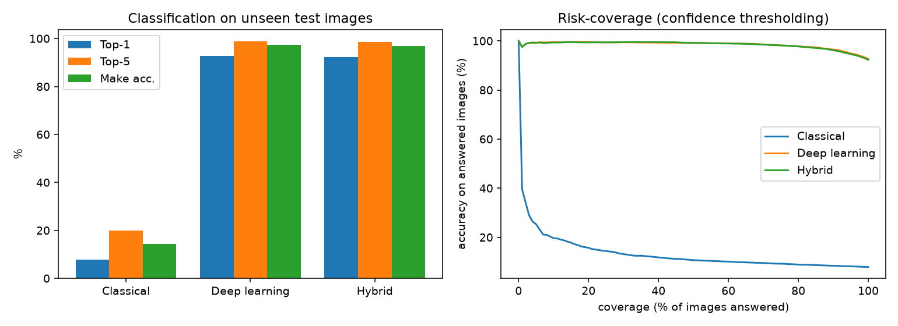

### 4.2 Finding the car

| Localiser | Mean IoU | Median IoU | IoU >= 0.5 | IoU >= 0.75 | AP@0.5 | AP@0.75 | mAP@[.5:.95] |
|---|---|---|---|---|---|---|---|
| Classical (edges + contours + GrabCut) | 0.650 | 0.654 | 78.7% | 31.0% | 0.627 | 0.105 | 0.217 |
| YOLO | 0.943 | 0.958 | 99.5% | 98.6% | 0.858 | 0.844 | 0.788 |
| YOLO + GrabCut refinement | 0.890 | 0.905 | 99.5% | 95.7% | 0.989 | 0.923 | 0.770 |
| Hybrid localiser (YOLO + refinement + classical fallback) | 0.892 | 0.905 | 99.7% | 95.8% | 0.989 | 0.923 | 0.771 |

Each Stanford Cars image has one annotated car, so we scored this as a single-class problem (mAP is the AP of the class "car", COCO 101-point interpolation). The AP numbers are not a like-for-like comparison. The raw YOLO row is scored on every box the detector outputs, so extra detections of other cars in the background count as false positives and pull its AP@0.5 down to 0.858. The two refined rows are scored on the single box we pick per image, which is why their AP@0.5 is higher (0.989). The IoU columns are fair to compare, and they show that GrabCut shaves a little off the IoU (0.943 to 0.890). That is the cost we see in the ablation.

The classical localiser alone is much weaker than YOLO (mean IoU 0.650 against 0.943), but it still finds the car well enough to be useful when YOLO fails.

### 4.3 Size and speed

| Item | Value |
|---|---|
| Classifier parameters | 27.97 M |
| Classifier checkpoint | 111.95 MB |
| Detector weights | 22.59 MB |
| Classical model | 5.01 MB |
| Hardware | NVIDIA GeForce RTX 4060 Laptop GPU |

| Approach | Localise (ms) | Classify (ms) | Total (ms) | Images/s |
|---|---|---|---|---|
| Classical | 190.3 | 13.0 | 203.3 | 4.9 |
| Deep learning | 12.8 | 7.8 | 20.7 | 48.4 |
| Hybrid | 234.2 | 29.4 | 263.6 | 3.8 |

These are per-image averages with batch size 1, including the classical image processing but not JPEG decoding. The hybrid is about 13 times slower than deep learning only, nearly all of it from the CPU-side contour and GrabCut steps. For 0.4 points less accuracy, that is not a good trade on clean images.

## 5. Ablation: what each part adds

### 5.1 Adding components one at a time

| Configuration | Top-1 | Top-5 | Change vs previous | 95% interval (pts) | Change vs DL baseline | 95% interval (pts) |
|---|---|---|---|---|---|---|
| DL baseline (YOLO box, then CNN) | 92.7% | 98.8% | +0.00 | [+0.00, +0.00] | +0.00 | [+0.00, +0.00] |
| + classical fallback localiser | 92.7% | 98.8% | -0.01 | [-0.04, +0.00] | -0.01 | [-0.04, +0.00] |
| + GrabCut box refinement | 92.2% | 98.7% | -0.44 | [-0.73, -0.14] | -0.45 | [-0.75, -0.15] |
| + illumination normalisation | 92.1% | 98.7% | -0.11 | [-0.25, +0.02] | -0.56 | [-0.88, -0.24] |
| + flip test-time augmentation | 92.3% | 98.6% | +0.17 | [+0.00, +0.35] | -0.39 | [-0.70, -0.06] |
| + classical feature fusion (alpha = 0) | 92.3% | 98.6% | +0.00 | [+0.00, +0.00] | -0.39 | [-0.70, -0.06] |
| + second pass (= full hybrid) | 92.3% | 98.6% | +0.00 | [+0.00, +0.00] | -0.39 | [-0.70, -0.06] |

Intervals come from a paired bootstrap with 2,000 resamples. No step gives a clear gain on clean test images. GrabCut refinement is the only step with a clearly negative effect. The others are within noise. The components that were meant for hard conditions (brightness correction, fallback localisation, second pass) should show their value in the robustness tests, so that is where to look (Section 8), and the picture there is also mixed.

### 5.2 Removing one component from the full hybrid

| Configuration | Top-1 | Change vs full | 95% interval (pts) |
|---|---|---|---|
| full hybrid | 92.3% | +0.00 | [+0.00, +0.00] |
| without classical fallback | 92.3% | +0.02 | [+0.00, +0.06] |
| without GrabCut refinement | 92.4% | +0.09 | [-0.20, +0.37] |
| without illumination normalisation | 92.4% | +0.07 | [-0.06, +0.21] |
| without flip TTA | 92.1% | -0.16 | [-0.34, +0.01] |
| without classical fusion | 92.3% | +0.00 | [+0.00, +0.00] |
| without second pass | 92.3% | +0.00 | [+0.00, +0.00] |

### 5.3 Where the crop comes from

| Box source (same CNN, nothing else changed) | Top-1 | Top-5 | Change vs YOLO |
|---|---|---|---|
| ground-truth box (upper bound) | 92.9% | 98.9% | +0.26 |
| whole image, no localisation | 87.4% | 96.7% | -5.31 |
| classical localiser only | 88.7% | 97.2% | -3.94 |
| YOLO (whole image if nothing is found) | 92.7% | 98.8% | +0.00 |
| YOLO + classical fallback | 92.7% | 98.8% | -0.01 |
| YOLO + GrabCut + classical fallback | 92.2% | 98.7% | -0.45 |

Localisation clearly matters when it is missing: feeding the whole image costs 5.3 points. Once the box is decent (YOLO), the extra classical steps add nothing.

### 5.4 Padding and fusion weight

| Padding | Top-1 |
|---|---|
| 0 | 92.3% |
| 0.03 | 92.2% |
| 0.06 | 92.4% |
| 0.10 | 92.0% |
| 0.15 | 91.9% |

| Fusion weight | Top-1 |
|---|---|
| 0 | 92.3% |
| 0.1 | 92.2% |
| 0.2 | 91.8% |
| 0.3 | 91.5% |
| 0.5 | 90.0% |
| 0.75 | 87.4% |
| 1 | 83.8% |

Padding barely matters. Fusion only hurts: the more weight we give the classical classifier, the worse the result gets, so the tuned weight ended up at zero. We kept the fusion code and reported it, but we do not claim it helps.

### 5.5 Classical feature groups (on ground-truth crops)

| Features | Dimensions | Top-1 | Top-5 |
|---|---|---|---|
| HOG only | 2772 | 17.7% | 38.2% |
| colour only | 140 | 6.2% | 16.1% |
| LBP texture only | 60 | 4.8% | 13.6% |
| geometry only | 33 | 2.5% | 8.9% |
| HOG + colour | 2912 | 20.1% | 42.1% |
| HOG + colour + LBP | 2972 | 20.7% | 42.8% |
| all four groups | 3005 | 20.8% | 43.5% |

HOG carries almost all of the signal. Colour helps a bit, and texture and shape add very little. This makes sense, since shape outlines are what distinguish models, and colour says little about which model it is.

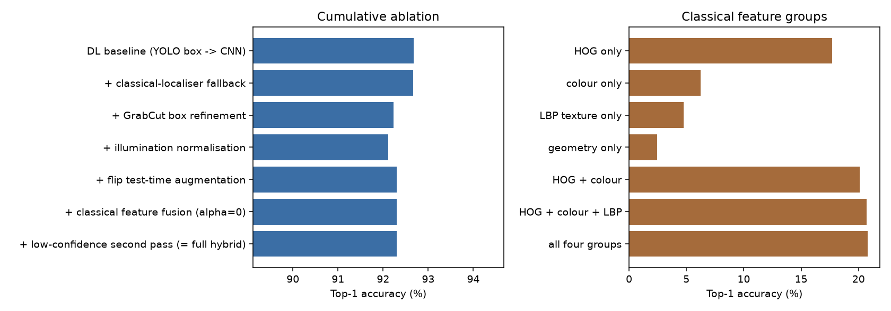

## 6. Telling similar cars apart

Hybrid errors split into three types: same make but wrong model (337 errors, 54%), wrong make (245, 40%), and right make and model but wrong year (38, 6%). So over half of the mistakes are between models of one manufacturer.

The most common confusions:

| True class | Predicted class | Count |
|---|---|---|
| Audi TTS Coupe 2012 | Audi TT Hatchback 2011 | 16 |
| Chevrolet Express Van 2007 | Chevrolet Express Cargo Van 2007 | 16 |
| Chevrolet Silverado 2500HD Regular Cab 2012 | Chevrolet Silverado 1500 Regular Cab 2012 | 12 |
| BMW 6 Series Convertible 2007 | BMW M6 Convertible 2010 | 11 |
| Dodge Caliber Wagon 2007 | Dodge Caliber Wagon 2012 | 11 |
| Dodge Caliber Wagon 2012 | Dodge Caliber Wagon 2007 | 10 |
| Ferrari 458 Italia Coupe 2012 | Ferrari 458 Italia Convertible 2012 | 10 |
| Audi V8 Sedan 1994 | Audi 100 Sedan 1994 | 10 |
| Bentley Continental GT Coupe 2007 | Bentley Continental GT Coupe 2012 | 8 |
| Audi 100 Sedan 1994 | Audi 100 Wagon 1994 | 8 |

Many of these pairs are cars that are nearly identical in the real world, such as the same model sold in two different years, or the Express Van and Express Cargo Van. The hardest classes were Chevrolet Express Van 2007 (40% correct), Audi TTS Coupe 2012 (57%), Chevrolet Silverado 2500HD Regular Cab 2012 (58%), Audi V8 Sedan 1994 (63%), Chevrolet Tahoe Hybrid SUV 2012 (65%) and Audi 100 Sedan 1994 (65%).

Stanford Cars has no viewpoint labels, so we used the shape of the ground-truth box as a rough stand-in (narrow boxes are mostly front, rear or three-quarter views, wide boxes are side views):

| Box shape | Images | Classical | Deep learning | Hybrid |
|---|---|---|---|---|
| narrow (front, rear, oblique) | 2680 | 9.7% | 93.4% | 93.1% |
| medium | 2680 | 7.2% | 94.3% | 93.7% |
| wide (side views) | 2681 | 6.8% | 90.4% | 90.1% |

Side views were the hardest for all three approaches, about 3 to 4 points below the medium group for the CNN.

## 7. Failure cases

Overall, 7.7% of the hybrid's answers were wrong. We grouped the errors into seven categories (an image can fall into more than one). For categories defined by an image property, we compare the error rate inside the group with the overall 7.7%. The "likely cause" text below is our explanation of the pattern. The numbers are measured, but the causes are our interpretation, and Grad-CAM pictures in the galleries show where the network was looking.

**1. Same model, wrong year (38 errors, 6% of all errors).** The make and model are right but the year is off, for example Bentley Continental GT Coupe 2007 predicted as 2012, Honda Odyssey 2007 as 2012, and the two Dodge Caliber Wagon years swapping both ways. The model is usually 100% confident in these. Likely cause: consecutive years differ in small details like a bumper, a grille or the wheels, which are only a few pixels wide at 256 px, so the evidence in the image is close to ambiguous.
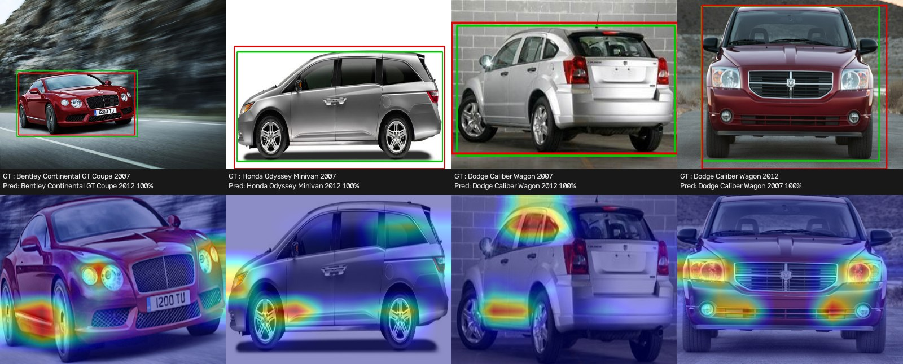

**2. Same make, wrong model (337 errors, 54%).** Examples: HUMMER H2 SUT predicted as H3T, Spyker C8 Convertible as Coupe, Bugatti Veyron Coupe as Convertible, Ferrari 458 Italia Coupe as Convertible. Likely cause: models from one manufacturer share a design language and often a body style, so the network gets the family right and misses the specific variant. Coupe versus convertible pairs, where only the roof differs, are a clear case.
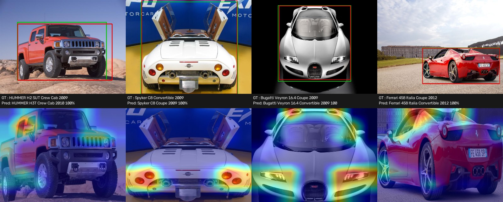

**3. Confident wrong make (245 errors, 40%).** Examples: Chevrolet Express Cargo Van predicted as GMC Savana Van (100% confident), Dodge Durango as Chrysler Aspen (99%), Mercedes-Benz Sprinter as Dodge Sprinter (99%). Several of these are the same vehicle sold under different badges, so the dataset labels themselves are arguable. Likely cause: genuinely look-alike vehicles, and possibly label noise. It also shows overconfidence that temperature scaling only partly fixes.
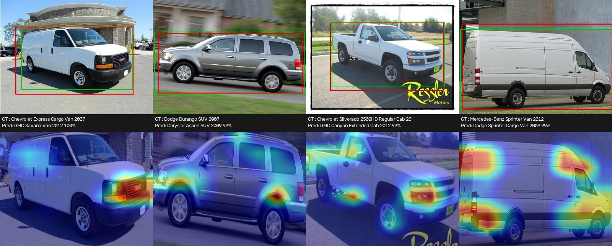

**4. Poorly placed box (13 errors, 2% of errors).** The error rate for images where the box overlaps the true one by less than 0.5 IoU is 50.0%, against 7.7% overall (6.5 times higher), though that group is small (26 images). Examples: AM General Hummer predicted as HUMMER H2 (IoU 0.45), and an Acura RL predicted as an Audi TTS with an IoU of 0.04, meaning the box was on something else. Likely cause: the box missed part of the car or sat on a different vehicle, so the crop lost the useful parts or contained distractions.
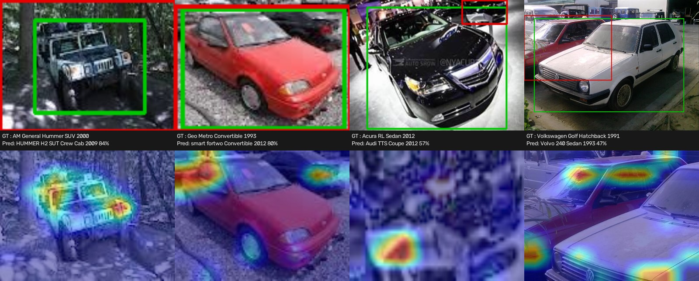

**5. Hard lighting (69 errors, 11% of errors).** Error rate on very dark or very bright images is 11.3%, against 7.7% overall (1.5 times higher), across 610 images. Likely cause: colour and fine edges are lost or noisy in dark or washed-out photos, and our brightness correction recovers only part of that. Several of the example mistakes in this group are also coupe/convertible or similar-model confusions, so lighting is not the only factor.
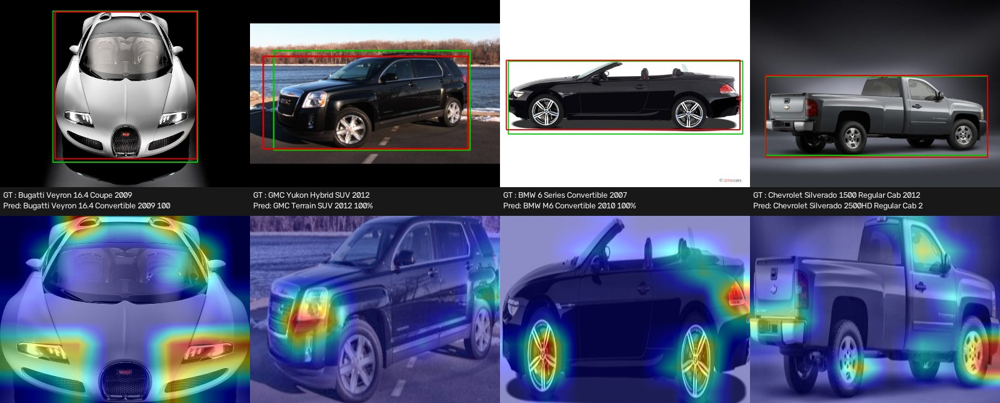

**6. Small vehicle (1 error).** Only 8 test images have a car smaller than 8% of the frame, and 1 of them was wrong (12.5%), so this category is too small to say much. It is here for completeness. The one error was a Maybach Landaulet predicted as a Dodge Caliber at 35% confidence. With our current accept threshold of 0.10 this is still answered, but a threshold of 0.4 or higher would have rejected it.
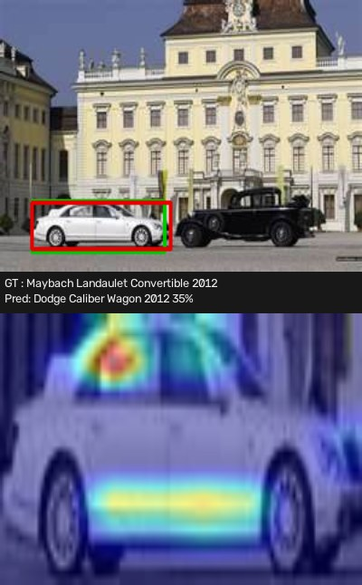

**7. Unusual viewpoint (114 errors, 18% of errors).** Error rate on images whose boxes have the most extreme aspect ratios (the outer 5% on each side) is 14.2%, across 804 images, against 7.7% overall (1.8 times higher). Likely cause: strongly head-on, rear or very oblique views are rarer in the training set.
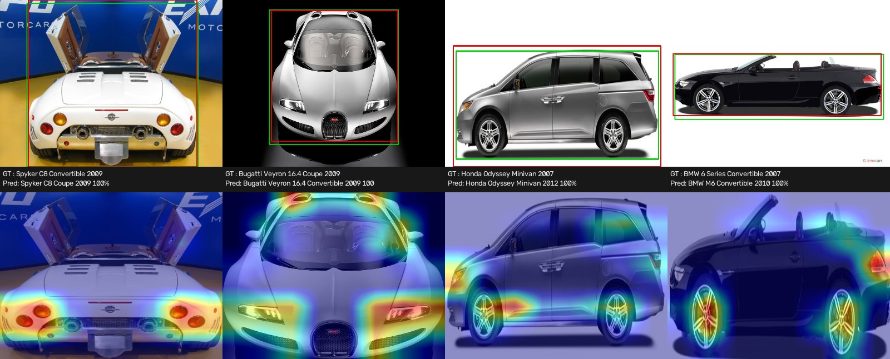

## 8. Robustness

We applied 15 kinds of damage to 200 random test images (seed 42) and ran all three approaches end to end. The "clean" row here is the same 200 images without damage.

| Condition | Classical | Deep learning | Hybrid | Hybrid mean confidence |
|---|---|---|---|---|
| clean | 7.5% | 93.5% | 93.5% | 93% |
| low light | 4.5% | 92.0% | 89.5% | 88% |
| very low light | 1.0% | 78.0% | 73.0% | 77% |
| overexposed | 7.5% | 93.0% | 93.5% | 93% |
| low contrast | 4.5% | 93.5% | 94.0% | 92% |
| Gaussian blur | 3.0% | 57.5% | 52.5% | 63% |
| motion blur | 3.5% | 85.5% | 83.5% | 83% |
| Gaussian noise | 3.5% | 91.5% | 90.5% | 90% |
| JPEG quality 10 | 8.0% | 82.5% | 81.5% | 84% |
| resolution x0.5 | 6.5% | 93.5% | 93.0% | 91% |
| resolution x0.25 | 4.5% | 86.5% | 82.5% | 84% |
| occlusion 25% | 2.5% | 85.5% | 84.0% | 87% |
| occlusion 50% | 2.0% | 64.5% | 63.5% | 73% |
| truncated 25% | 2.5% | 92.5% | 91.0% | 92% |
| rotation +/-15 degrees | 2.0% | 93.5% | 91.5% | 91% |
| perspective warp | 6.5% | 93.0% | 94.0% | 93% |

The three biggest hybrid drops from clean are Gaussian blur (-41.0 points), 50% occlusion (-30.0) and very low light (-20.5). These are the conditions where the system really struggles, and in all three the confidence also falls (63%, 73% and 77%), which is the right direction, since lower confidence is what the rejection step needs.

The hybrid is never more than 0.5 points ahead of deep learning only (overexposed, low contrast and perspective warp, all within noise). Deep learning alone is ahead by about 2 points or more in low light, very low light, both kinds of blur, quarter resolution and rotation. We expected the brightness correction to help in the low-light rows, and it didn't (92.0% for DL against 89.5% for hybrid at low light). A possible reason is that the CNN was already trained with random gamma and brightness changes, so it had learned to cope, and the extra correction just changed the image. We did not test that explanation.

With 200 images, a difference of a couple of points is within sampling noise (the standard error is about 2 points at 90% accuracy), so only the large drops should be read as findings. Rotation and perspective warp are our substitute for real viewpoint change. Occlusion is a grey patch over 25% or 50% of the car box, and truncation cuts off 25% of the car's width.

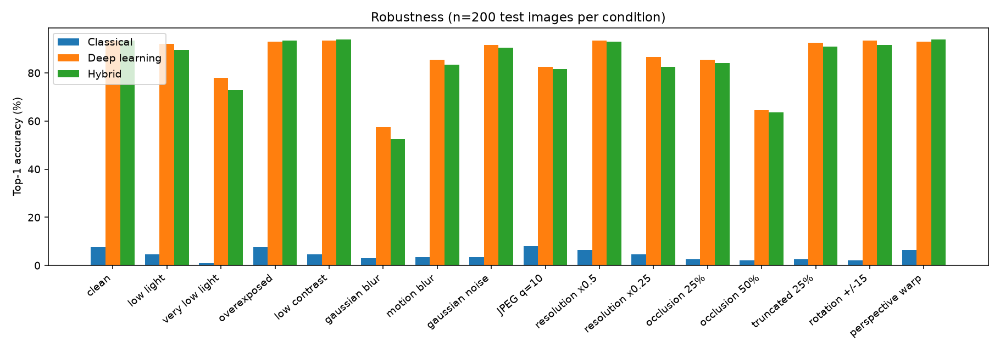
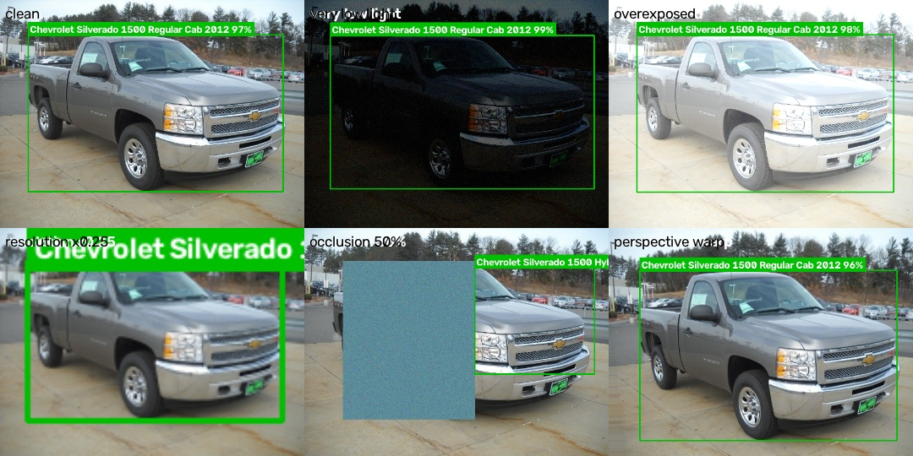

## 9. Confidence and low-confidence handling

Temperature scaling (T = 0.58, fitted on validation logits) brought the CNN's calibration error (ECE) from 0.178 down to 0.018 on the test set, and the negative log-likelihood from 0.489 to 0.305.

| Approach | ECE | NLL | Mean confidence | Top-1 |
|---|---|---|---|---|
| Classical | 0.325 | 6.805 | 40.4% | 7.9% |
| Deep learning | 0.018 | 0.305 | 93.1% | 92.7% |
| Hybrid | 0.019 | 0.321 | 92.5% | 92.3% |

After calibration, the deep-learning and hybrid models are close to honest: they report 93% confidence and are right about 93% of the time. The classical model is badly over-confident (40% average confidence for 8% accuracy).

What happens if we reject low-confidence answers (hybrid system):

| Threshold | Share answered | Accuracy on answered images | Rejected |
|---|---|---|---|
| 0.00 | 100.0% | 92.3% | 0.0% |
| 0.10 | 100.0% | 92.3% | 0.0% |
| 0.20 | 99.6% | 92.6% | 0.4% |
| 0.30 | 98.9% | 93.0% | 1.1% |
| 0.40 | 97.6% | 93.7% | 2.4% |
| 0.50 | 95.7% | 94.4% | 4.3% |
| 0.60 | 93.3% | 95.2% | 6.7% |
| 0.70 | 90.6% | 96.0% | 9.4% |
| 0.80 | 86.9% | 96.8% | 13.1% |
| 0.90 | 81.2% | 97.6% | 18.8% |
| 0.95 | 75.4% | 98.1% | 24.6% |

Raising the threshold trades coverage for accuracy in a smooth, useful way: at 0.90 the system answers 81% of images and is right 97.6% of the time on those.

One thing we have to be upfront about: the thresholds that our validation procedure picked (accept at 0.10, make-only at 0.60) do almost nothing on the test set. We told the tuning step to aim for 90% accuracy on accepted answers, but the classifier already exceeds that on validation, so the rule chose the lowest possible threshold. With those settings the system answers 100% of the test images with a full make/model/year label, gives zero make-only answers and rejects none. The table above shows what stricter thresholds would do, and the app's sidebar lets you set the threshold live (try 0.9). If we had more time, we would re-run the tuning with a stricter target such as 97% accuracy, which should land somewhere around the 0.8 to 0.9 rows.

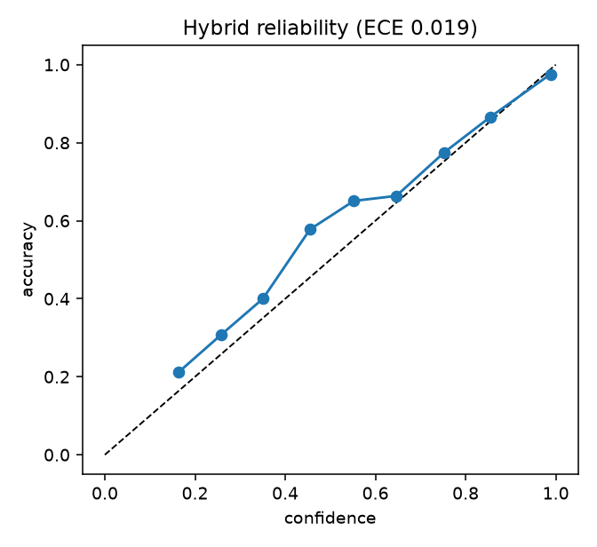

## 10. Model optimisation

| Variant | Size (MB) | gzip (MB) | Top-1 | Change | Latency, batch 1 (ms) | Throughput, batch 32 (img/s) |
|---|---|---|---|---|---|---|
| FP32 (GPU) | 111.95 | 104.23 | 91.0% | +0.00 | 5.5 | 205 |
| FP16 (GPU) | 56.01 | 51.98 | 91.0% | +0.00 | 5.6 | 471 |
| FP32 (CPU) | 111.95 | 104.23 | 91.0% | +0.00 | 45.8 | 27 |
| INT8 dynamic, linear layers (CPU) | 33.89 | 25.71 | 91.6% | +0.60 | 32.2 | 48 |
| Pruned 30% (global L1, GPU) | 111.95 | 83.15 | 81.2% | -9.80 | 5.2 | 204 |
| Pruned 50% (global L1, GPU) | 111.95 | 66.01 | 10.4% | -80.60 | 5.2 | 203 |
| Pruned 30% + FP16 (GPU) | 56.01 | 43.73 | 81.2% | -9.80 | 5.7 | 448 |

This is measured on the first 500 test images (hence 91.0% rather than 92.7%), with torch 2.14.1+cu130.

- **FP16** is the clear win on a GPU: half the size, no accuracy loss, and 2.3 times the throughput at batch 32. At batch size 1 the latency is the same, because one image does not keep the GPU busy.
- **Dynamic INT8** shrinks the model to 33.89 MB (about 30% of the original), makes CPU inference faster (45.8 ms down to 32.2 ms) and did not hurt accuracy on this subset. The +0.6 point difference is noise on 500 images.
- **Pruning** hurt a lot. Removing 30% of weights without retraining cost about 10 points, and 50% broke the model completely (10.4%). We did no fine-tuning after pruning, which would be needed to make it usable. The saved file does not get smaller, since the zeroed weights are still stored, and the speed does not change because the dense kernels do the same work. The only gain shows up in the compressed size.

For the detector, FP32 and FP16 both ran at a median of 9.5 ms per image, so there was no difference.

## 11. The application

Run `streamlit run app.py`. It has five tabs:

1. **Recognition**: upload a photo, see the detected car with its bounding box, the predicted make, model and year, the confidence, the accept/make-only/reject decision and the top-5 candidates.
2. **Image-processing steps**: the intermediate results, including brightness correction, edges, contours, the GrabCut region, HOG, LBP, the colour histogram and the shape measurements.
3. **Compare approaches**: classical, deep learning and hybrid side by side on the same image.
4. **Benchmarks**: the offline results from this report.
5. **About**.

The hybrid components and the confidence thresholds can be switched on and off live in the sidebar.

## 12. Limitations

- Everything comes from one training run and one random seed, so differences well under a point should not be over-read (this is why we give bootstrap intervals).
- The robustness corruptions are synthetic and use only 200 images. Real bad weather, real motion blur and real night photos could behave differently.
- There are no viewpoint labels in Stanford Cars, so our viewpoint analysis uses box shape and synthetic rotations as proxies.
- Some year and trim distinctions are nearly invisible in the photos, so a part of the error cannot be removed at this resolution.
- The classical features add little to a CNN this strong. In the final system they help with the fallback localiser and the second opinion on difficult crops, but not with the clean-image score.
- We did not fine-tune the YOLO detector on Stanford Cars and used the pre-trained weights. It was already very good (99.5% of boxes with IoU of at least 0.5), but fine-tuning could be tried.
- We trained for 10 epochs to save time. A longer run might add a point or two.
- The confidence thresholds chosen by validation are too permissive (Section 9). We explained why and what to do about it.
- Number-plate recognition, tracking and traffic events are out of scope.

## 13. Reproducing the results

```
python train_detector.py --data-root <path>      # optional: fine-tune YOLO on Stanford Cars boxes (we skipped this)
python train.py --data-root <path>               # fine-tune the CNN classifier
python train_classical.py --data-root <path>     # classical feature classifier
python tune_hybrid.py --data-root <path>         # fusion weight, padding and thresholds on validation data
python evaluate.py --data-root <path>            # main test evaluation
python ablation.py ; python robustness.py ; python optimize.py ; python failure_analysis.py
streamlit run app.py
```

Or `python run_all.py --data-root <path> --fast`, which is what we used (10 epochs, no detector fine-tuning, smaller robustness and optimisation subsets). Seed 42, Python 3.11.9. The settings behind the reported numbers: padding 0, GrabCut refinement on, illumination normalisation on, flip averaging on, fusion off (alpha 0), second pass on, classical fallback on, accept threshold 0.103, make-level threshold 0.6, detector `yolov8s.pt`.

## 14. Requirement checklist

| Requirement | Where |
|---|---|
| Tell similar makes, models and years apart | Section 4.1 (make / make+model / exact), Section 6 |
| Different lighting and viewing angles | Section 8 (lighting, rotation, perspective), viewpoint stand-in in Section 6 |
| Partial occlusion and different resolutions | Section 8 (occlusion 25% and 50%, truncation, half and quarter resolution) |
| Classical vs deep learning vs hybrid | Section 4 |
| Ablation | Section 5 |
| Model optimisation (FP16, INT8, pruning) | Section 10 |
| Evaluation on unseen test images | Section 4 (the test set was never used for tuning) |
| At least three failure cases with causes | Section 7 (seven categories) |
| Top-1/Top-5, IoU, mAP, size and speed, robustness, confidence | Sections 4, 8 and 9 |
